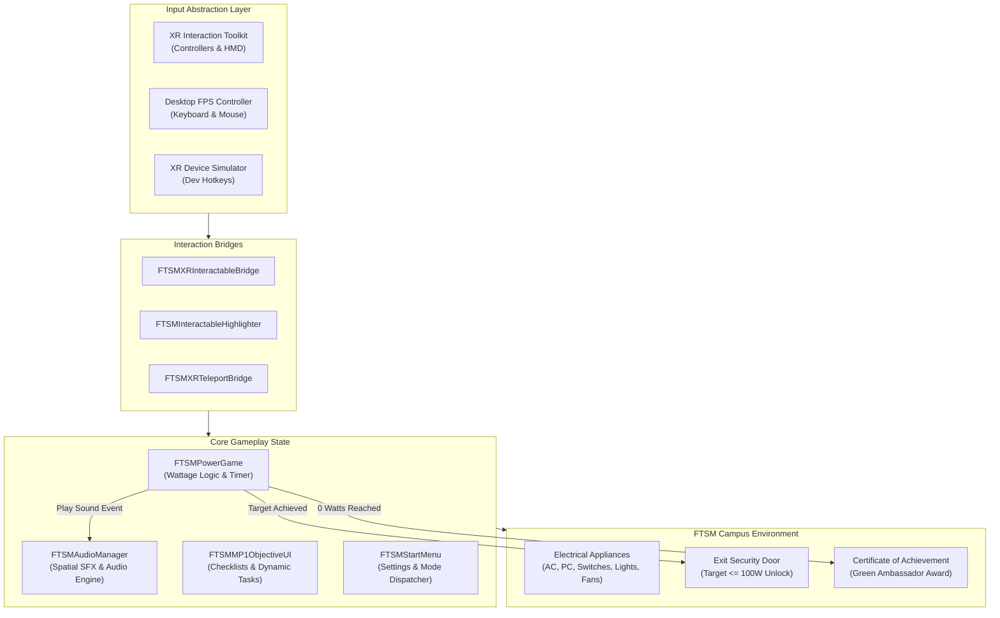

# FTSM Lestari Walkthrough: UKM Virtual Energy Audit & Campus Exploration VR Game 🎓🌿
### *An Interactive Virtual Reality (VR) Environmental Walkthrough & Energy Conservation Mini-Game Built for Universiti Kebangsaan Malaysia (UKM) FTSM*

<p align="center">
  <a href="https://youtu.be/qtZvjtcVDHM"></a>
  
  
  
  
  
  
  
  
  <a href="mailto:moyunxuan0@gmail.com"></a>
</p>

---

## 📖 Table of Contents
- [📌 1. Project Overview & Academic Background](#-1-project-overview--academic-background)
- [🖼️ 2. Visual Walkthrough & Gameplay Highlights](#️-2-visual-walkthrough--gameplay-highlights)
- [✨ 3. Key Features & Gameplay Mechanics](#-3-key-features--gameplay-mechanics)
- [🎮 4. Controls & Input Mapping (VR vs. Desktop FPS)](#-4-controls--input-mapping-vr-vs-desktop-fps)
- [📐 5. System Architecture & Technical Implementation](#-5-system-architecture--technical-implementation)
- [🏢 6. Campus Virtual Twin & Room Environments](#-6-campus-virtual-twin--room-environments)
- [📂 7. Project Directory Structure](#-7-project-directory-structure)
- [🚀 8. How to Run & Build](#-8-how-to-run--build)
- [👨‍💻 9. Author Attribution & Academic Acknowledgments](#-9-author-attribution--academic-acknowledgments)

---

## 📌 1. Project Overview & Academic Background

**FTSM Lestari Walkthrough** is an interactive, first-person Virtual Reality (VR) serious game and 3D architectural exploration experience developed as a flagship coursework project for the **Virtual Reality (VR) curriculum** at the **Faculty of Information Science and Technology (FTSM), Universiti Kebangsaan Malaysia (UKM)**.

### Academic Context & Green Campus Initiative
Rooted in UKM's institutional **"Kampus Lestari" (Sustainable Eco-Campus)** initiative, the project challenges players to act as a **Campus Green Ambassador and Energy Auditor**. 

Upon entering the virtual recreation of FTSM's main teaching and administrative facilities, players discover that classrooms, computer laboratories, and academic offices have been left with unneeded electrical equipment running at an alarming power consumption rate exceeding **18,100 Watts**. Players must explore each zone, inspect appliances, and switch off idling equipment (desktop computers, commercial split-unit air conditioners, ceiling fans, fluorescent lights, projectors, coffee machines, and microwave ovens) before a **180-second countdown timer** expires, lowering total energy consumption to a safe threshold below **100 Watts** to unlock the exit door and receive the official **UKM FTSM Green Ambassador Certificate of Achievement**.

---

## 🖼️ 2. Visual Walkthrough & Gameplay Highlights

> [!TIP]
> 📺 **Watch Full Gameplay Video on YouTube**: [https://youtu.be/qtZvjtcVDHM](https://youtu.be/qtZvjtcVDHM)  
> All screenshots below are captured in real-time from the 60 FPS VR inspection playthrough.

| 1. VR Start Menu & Experience Portal | 2. Audio Settings & Desktop "No VR" Toggle |
|:---:|:---:|
|  |  |
| *Immersive in-game 3D start menu rendered inside virtual FTSM lab* | *Independent Music/SFX sliders and one-click "No VR Mode" toggle* |

| 3. MP1 Lab Energy Saving Guide & Objective HUD | 4. Shutting Down Commercial Air Conditioners |
|:---:|:---:|
|  |  |
| *Interactive wall guide checklist; baseline power starts at 18,100 Watts* | *Controller raycast turns off high-wattage AC units (-1,500W each)* |

| 5. Wall Light Switches Interaction | 6. Corridor & Faculty Pantry Area |
|:---:|:---:|
|  |  |
| *Targeting individual gang switches to extinguish room fluorescent lights* | *Auditing pantry microwaves, coffee makers, and student lounge TVs* |

| 7. Bilik Kuliah BK1 (Lecture Hall 1) | 8. Academic Staff Office Inspection |
|:---:|:---:|
|  |  |
| *Inspecting projector screens, lecturer podium PCs, and wall fans* | *Auditing lecturer workstations, personal desk fans, and office printers* |

| 9. Victory Achievement: UKM FTSM Green Ambassador Certificate |
|:---:|
|  |
| *Reaching 0 Watts unlocks the golden Dean's Certificate of Achievement!* |

---

## ✨ 3. Key Features & Gameplay Mechanics

### 1. Dual Playmode Architecture (Full VR + Desktop FPS)
- **Native OpenXR VR Mode**: Built upon Unity's modern **XR Interaction Toolkit (XRI)**. Full 6-DoF tracking with spatial hand controllers (Meta Quest Touch, Oculus Touch, Valve Index Knuckles, HTC Vive Wands).
- **Desktop "No VR Mode" (Keyboard & Mouse)**: Designed to ensure accessibility for instructors, evaluators, and students without access to VR headsets. Toggling `No VR Mode` switches camera locomotion to standard WASD keyboard controls, mouse pitch/yaw look, and a dynamic screen crosshair.
- **XR Device Simulator**: Includes built-in developer controller simulation for debugging spatial controller rays without requiring a tethered headset.

### 2. Physical & Raycast Dual Interaction System
- **Long-Range Laser Raycast**: Green targeting laser beam emitted from motion controllers with quadratic bezier curves for pinpoint target selection across large lecture halls.
- **Dynamic Interaction Highlighting (`FTSMInteractableHighlighter.cs`)**: Aiming at any interactive appliance triggers real-time shader edge highlighting and contextual hover tooltips (`FTSMInteractionPromptUI.cs`).
- **Smooth Teleport Locomotion (`FTSMXRTeleportInteractableBridge.cs`)**: Comfort-first parabolic arc teleportation and snap turning to minimize VR simulator sickness.

### 3. Realistic Wattage Math & Energy Economy
Every electrical appliance in the virtual campus is mapped to true-to-life physical power consumption ratings:

| Electrical Equipment Category | Unit Wattage (Approx.) | Quantity Across Campus | Total Load Contribution |
|:---|:---:|:---:|:---|
| **Commercial Split Air Conditioner** | $1,500\text{ W}$ | 5 units | $7,500\text{ W}$ |
| **Student Workstation PC & CRT/LCD Monitor** | $250\text{ W}$ | 35 units | $8,750\text{ W}$ |
| **Pantry Microwave Oven** | $1,000\text{ W}$ | 1 unit | $1,000\text{ W}$ |
| **Faculty Coffee Brewer Machine** | $800\text{ W}$ | 1 unit | $800\text{ W}$ |
| **Ceiling Fans & Desk Fans** | $75\text{ W}$ | 7 units | $525\text{ W}$ |
| **Fluorescent Light Tube Arrays** | $40\text{ W}$ | 12 banks | $480\text{ W}$ |
| **Classroom Projector & Presentation TV** | $300\text{ W}$ | 3 units | $900\text{ W}$ |
| **Total Baseline Starting Power** | — | — | **$18,100\text{ W}$** |

### 4. Dynamic Objectives HUD & Audio Feedback
- **Real-Time Room Checklist (`FTSMMP1ObjectiveUI.cs`)**: The left HUD dynamically updates checklist progress with green checkmarks ($\checkmark$) as appliances are deactivated in each room.
- **Live Power Gauge (`FTSMTotalPowerUI.cs`)**: Top-right HUD renders real-time wattage reduction animations (e.g. green delta indicator `-1500 W`).
- **Spatial 3D Audio Cue System (`FTSMAudioManager.cs`)**: Features realistic mechanical rocker switch clicks, electric relay shutdowns, fan motor deceleration sound effects, ambient background audio, and triumphant fanfare upon level completion.

---

## 🎮 4. Controls & Input Mapping (VR vs. Desktop FPS)

### 🥽 VR Motion Controllers (Meta Quest / SteamVR)

| Action | Controller Input |
|:---|:---|
| **Raycast Interact / Click Switch** | Right Index Trigger (Press) |
| **Teleport Locomotion** | Left Thumbstick (Push forward to aim arc, release to blink) |
| **Snap Turn / Continuous Rotate** | Right Thumbstick (Flick Left / Right) |
| **Open Pause / Settings Menu** | Left Controller Menu Button (`Start`) |
| **Hover Tooltip / Laser Pointer** | Direct controller pointing at target object |

### 💻 Desktop PC ("No VR Mode")

| Action | Keyboard / Mouse Input |
|:---|:---|
| **Movement** | `W` (Forward), `S` (Backward), `A` (Left), `D` (Right) |
| **Look Around / Aim** | Mouse Movement (Yaw & Pitch) |
| **Interact / Toggle Appliance** | Left Mouse Button (Click on Crosshair) |
| **Sprint / Fast Walk** | `Left Shift` (Hold) |
| **Pause / Return to Menu** | `Escape` (`Esc`) Key |

---

## 📐 5. System Architecture & Technical Implementation

The game is built with an event-driven, decoupled C# architecture running on top of **Unity's Universal Render Pipeline (URP)**:



### Key C# Classes Breakdown:
- **`FTSMPowerGame.cs`**: Central game loop. Tracks total initial wattage, calculates real-time power deductions on interaction, monitors 180s countdown timer, and controls the exit security door unlock trigger.
- **`FTSMInteractable.cs` & `FTSMXRInteractableBridge.cs`**: Pluggable interaction interfaces that connect Unity XR raycast events with custom appliance behaviors.
- **`FTSMStartMenu.cs`**: Handles seamless mode switching between standard desktop FPS and immersive OpenXR VR modes.
- **`FTSMAudioManager.cs`**: Manages master volume, sound effect channels, and spatial 3D audio listener configurations.

---

## 🏢 6. Campus Virtual Twin & Room Environments

The environment reproduces key real-world architectural facilities inside UKM FTSM:

1. **`MP1` (Makmal Pengaturcaraan 1 - Computer Programming Lab)**:
   - High-density computer laboratory with 33 student desktop workstations and 1 lecturer master PC.
   - Dual high-capacity split air conditioner systems and multi-gang lighting switches.
2. **`BK1` (Bilik Kuliah 1 - Main Lecture Hall)**:
   - Tiered lecture hall featuring projection screens, podium lecture terminal, and ceiling-mounted fans.
3. **`Staff_Office` (Academic Staff & Lecturer Office)**:
   - Partitioned faculty desks with personal desktop computers, document printers, desk fans, and local lighting.
4. **`Corridor & Pantry` (Student Lounge & Common Hallway)**:
   - Vending area, coffee machine, microwave, water heater, and lounge television.

---

## 📂 7. Project Directory Structure

```
FTSM_Lestari_Walkthrough/
├── Assets/
│   ├── FTSMAudioManager.cs                 # Spatial audio manager
│   ├── FTSMForcedXRControls.cs             # XR input enforcement
│   ├── FTSMInteractable.cs                 # Core interactable base class
│   ├── FTSMInteractableHighlighter.cs      # Raycast hover glow shader
│   ├── FTSMInteractionPromptUI.cs          # World-space interactive tooltip
│   ├── FTSMMP1ObjectiveUI.cs               # Lab objective task checklist
│   ├── FTSMPlayerController.cs             # Desktop FPS player movement
│   ├── FTSMPowerGame.cs                    # Power calculation & game loop
│   ├── FTSMRoomInteractable.cs             # Room transition & door trigger
│   ├── FTSMStartMenu.cs                    # Main start & pause menu
│   ├── FTSMTeleportInteractable.cs         # VR teleportation targets
│   ├── FTSMTotalPowerUI.cs                 # Total wattage live HUD
│   ├── FTSMXRInteractableBridge.cs         # Unity XRI controller bridge
│   ├── Poster/                             # UKM FTSM energy posters & decals
│   ├── Prefabs/                            # Reusable appliances & UI prefabs
│   ├── Scenes/
│   │   ├── GAME.unity                      # Main integrated game scene
│   │   ├── BK1.unity                       # Lecture hall test environment
│   │   ├── MP1.unity                       # Programming lab environment
│   │   └── Staff_Office.unity              # Faculty office environment
│   ├── SocketsAndSwitches/                 # Physical switch & wall models
│   ├── sound/                              # Audio SFX clips (clicks, hums, jingles)
│   └── VNB - Office Set/                   # Realistic 3D furniture & props
├── Packages/                               # Package manifest (URP, XRI, OpenXR)
├── ProjectSettings/                        # Unity project settings & tags
├── docs/
│   └── images/
│       └── screenshots/                    # 60 FPS production screenshots
└── README.md                               # Complete project documentation
```

---

## 🚀 8. How to Run & Build

### Option A: Standalone Windows Execution (Instant Play)
1. Download the pre-built standalone package from the [Releases](https://github.com/MOYUNXUAN4/FTSM_Lestari_Walkthrough_Game/releases) section;
2. Extract the archive and launch `FTSM Lestari Walkthrough.exe`;
3. On the main menu:
   - For **VR Headset**: Ensure your headset (Oculus Link / Meta Quest Link / SteamVR) is connected, and click **Play**.
   - For **Standard PC Keyboard & Mouse**: Click **Setting**, enable **No VR Mode**, return, and click **Play**!

### Option B: Opening & Building in Unity Editor
1. Install **Unity 2022.3 LTS** (or compatible Unity 6) via Unity Hub;
2. Ensure the **Universal Render Pipeline (URP)** and **XR Interaction Toolkit** modules are loaded;
3. Open the project folder in Unity Hub;
4. Open the primary scene at `Assets/Scenes/GAME.unity`;
5. Press the **Play** button inside the editor or navigate to `File` $\rightarrow$ `Build Settings` $\rightarrow$ `Build` for Windows Standalone (x86_64).

---

## 👨‍💻 9. Author Attribution & Academic Acknowledgments

- **Lead Developer & Author**: **MOYUNXUAN**
- **Contact Email**: [moyunxuan0@gmail.com](mailto:moyunxuan0@gmail.com)
- **Academic Affiliation**: Faculty of Information Science and Technology (FTSM), Universiti Kebangsaan Malaysia (UKM).
- **Coursework Topic**: Virtual Reality (VR) Serious Games & Interactive Architectural Visualization.
- **License**: Released under the open-source [MIT License](LICENSE).
- **GitHub Repository**: [https://github.com/MOYUNXUAN4/FTSM_Lestari_Walkthrough_Game](https://github.com/MOYUNXUAN4/FTSM_Lestari_Walkthrough_Game)
- **Developer GitHub Profile**: [https://github.com/MOYUNXUAN4](https://github.com/MOYUNXUAN4)
- **Gameplay Demonstration**: [YouTube Live Gameplay Video](https://youtu.be/qtZvjtcVDHM)
